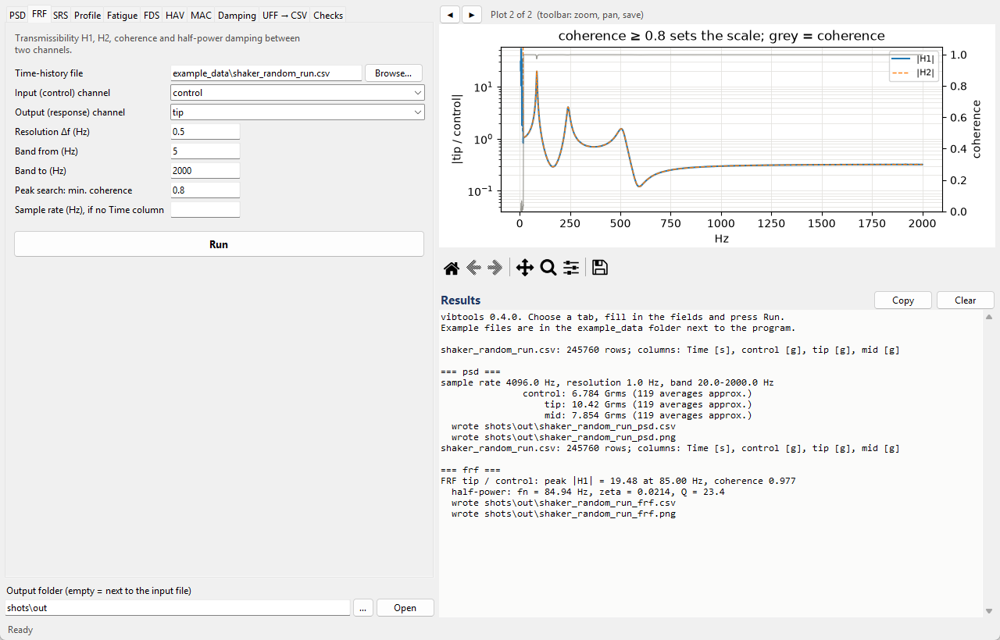
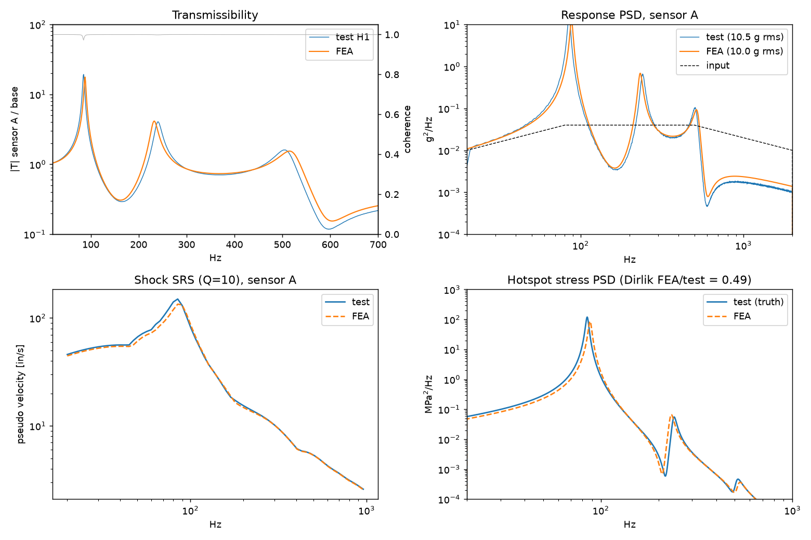
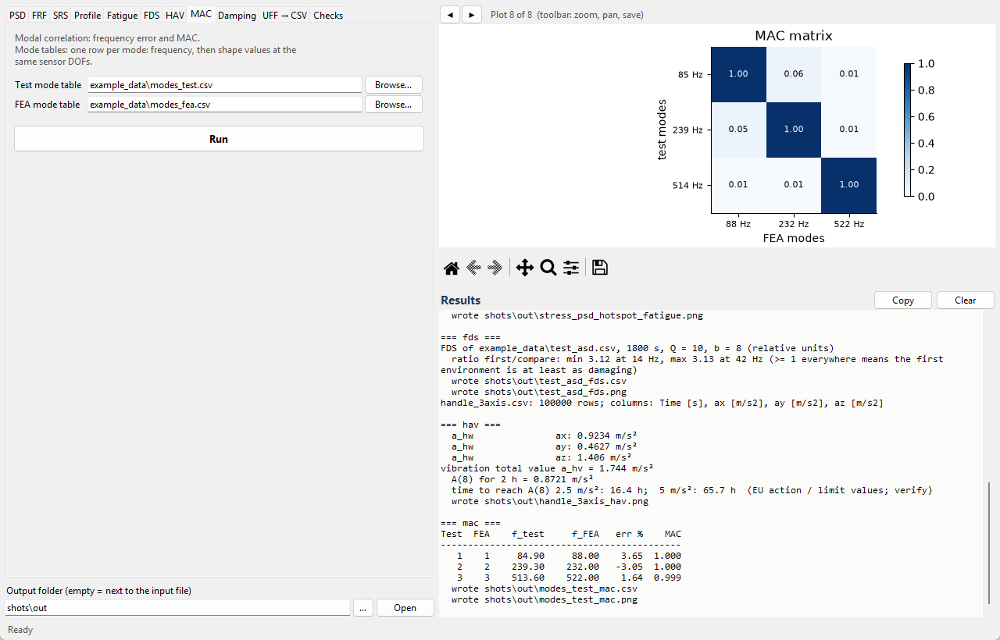
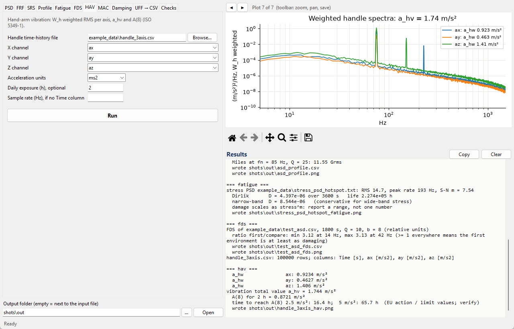

# vibtools

[](https://github.com/hamidattaran/vibtools/actions/workflows/tests.yml)


Python tools for processing shock and vibration test data and correlating it with finite-element
results (ANSYS, CalculiX, Abaqus or any solver that exports text tables).

It covers the everyday work of a vibration engineer: PSDs and Grms, transmissibility and coherence,
damping from test data, shock response spectra, random-vibration fatigue, modal correlation (MAC),
hand-arm vibration, and quick hand-calculation checks. Every method is validated against closed-form
solutions or published reference values (see [Validation](#validation)).

Use it as a Python library, from the command line, or through a desktop window. A standalone Windows
build that needs no Python is attached to each [release](https://github.com/hamidattaran/vibtools/releases).



## Quick start

```bash
git clone https://github.com/hamidattaran/vibtools.git
cd vibtools
pip install -e ".[demo,test]"

python -m pytest -q                          # 27 validation tests, a few seconds
python examples/make_example_data.py         # synthetic test files in ./example_data
python -m vibtools.gui                       # desktop window
python examples/demo_correlation.py          # end-to-end test-vs-FEA demo, writes demo_output.png
```

Requires Python 3.11+, numpy and scipy. matplotlib is needed for plots, pytest for the tests.

## Command line

Every common task is a command: `python -m vibtools <command>` (or `vibtools.exe <command>` in the
standalone build). `python -m vibtools <command> -h` lists the options.

| Command | Does |
| --- | --- |
| `psd` | PSD and Grms of time-history channels |
| `frf` | H1, H2, coherence and half-power damping between a control and a response channel |
| `srs` | shock response spectrum, pseudo velocity, velocity change |
| `profile` | Grms, table velocity and displacement RMS of an ASD profile (file or breakpoints); Miles' equation |
| `fatigue` | Dirlik and narrow-band fatigue damage from a stress PSD |
| `fds` | fatigue damage spectrum, optionally test vs service |
| `hav` | ISO 5349-1 W_h weighted RMS per axis, vibration total value, A(8) |
| `mac` | modal correlation table (frequency error, MAC) from test and FEA mode tables |
| `damping` | damping from a free decay (log decrement), a response PSD (half-power at −3 dB) or a multi-mode FRF fit |
| `uff2csv` | convert UFF dataset 58 blocks to CSV |
| `demo`, `benchmark`, `selftest` | run the examples and a quick validation |

Inputs are text/CSV tables with one header row (FEA exports work directly) or UFF 58 files.
Results are printed and written as `<input>_<command>.csv` and `.png`.

```bash
python -m vibtools frf example_data/shaker_random_run.csv --input control --output tip
python -m vibtools srs example_data/shock_halfsine.csv --channel tip
python -m vibtools fatigue example_data/stress_psd_hotspot.txt
```

## Library

| Module | Contents |
| --- | --- |
| `spectral` | `psd_welch`, `grms`, `frf_estimates` (H1, H2, coherence), `asd_from_breakpoints`, `grms_from_breakpoints`, `velocity_from_asd`, `synth_gaussian`, `campbell_orders` |
| `sdof` | ramp-invariant SDOF filters, analytic transmissibility, Miles, mode superposition (`modal_response`, `modal_transmissibility`, `modal_rel_frf`) |
| `shock` | `srs` (absolute acceleration, relative displacement, pseudo velocity), `octave_freqs`, `half_sine`, `velocity_change`, `srs_compare` |
| `modal` | `mac`, `freq_error_pct`, `pair_modes`, `correlation_table`, `half_power_damping`, `half_power_damping_psd`, `log_decrement`, `fit_modes` (multi-mode), `fit_transmissibility`, `psd_metrics` |
| `fatigue` | `SN`, Goodman/Gerber, `miner`, `dwell_damage`, `sweep_damage`, spectral moments, `narrowband_damage`, `dirlik_damage`, `steinberg_damage`, `equivalent_test_time`, `rainflow`, `rainflow_damage`, `fds_random`, `fds_time` |
| `hav` | `wh_response`, `wh_weight` (ISO 5349-1 W_h), `weighted_rms`, `weighted_rms_from_asd`, `vibration_total_value`, `daily_exposure` (A(8)), `time_to_reach` |
| `io` | `read_table` (FEA text/CSV exports), `read_uff58`, `write_uff58` (UFF dataset 58, ASCII) |
| `handcalc` | stress–velocity checks (`stress_from_velocity`, `velocity_limit`, `drop_sdof`, `quick_check`), typical material values |

```python
import numpy as np
from vibtools import spectral, modal, shock, fatigue, SN

# 1. Test data: control (base) and response accelerometers, in g
f, H1, H2, coh = spectral.frf_estimates(base_g, resp_g, fs, df=0.5)
hp = modal.half_power_damping(f, np.abs(H1), f_range=(70, 110))     # fn, zeta, Q
f_psd, psd = spectral.psd_welch(resp_g, fs, df=1.0)
print(spectral.grms(f_psd, psd, 20, 2000))                          # always quote the band

# 2. FEA modes sampled at the same sensors and directions as the test
print(modal.format_table(modal.correlation_table(f_test, f_fea, phi_test, phi_fea)))

# 3. Shaker table motion from the control ASD: 1-sigma velocity and displacement
tm = spectral.velocity_from_asd(f_ctrl, asd_ctrl_g2hz, 20, 2000)  # dict: v_rms [m/s], d_rms [m]

# 4. Shock: acceleration in m/s^2 gives pseudo velocity in m/s
res = shock.srs(accel_ms2, fs, shock.octave_freqs(20, 1000, 12), Q=10)

# 5. Fatigue from an FEA stress PSD at the hotspot (MPa^2/Hz)
sn = SN.from_points((200.0, 1e5), (100.0, 1e7))                     # replace with your S-N data
print(fatigue.dirlik_damage(f_stress, psd_stress, T=7200.0, sn=sn)["D"])
```

## Examples

* `examples/demo_correlation.py`: synthetic three-mode specimen on a shaker. Simulates the test,
  extracts transmissibility, damping, SRS and fatigue, and compares them with the "FEA" model.
* `examples/benchmark_cantilever.py`: reference solution for an FEA benchmark (aluminium cantilever
  with a tip mass on a shaker: modal, harmonic, random, shock). Build the same model in your FEA code
  and compare.
* `examples/make_example_data.py`: writes the synthetic input files used by the commands and the window.



| Modal correlation (MAC) | Hand-arm vibration (ISO 5349-1) |
| --- | --- |
|  |  |

## Conventions

* One-sided PSDs. g in gives g²/Hz out. Stress PSDs are in (stress unit)²/Hz.
* `SN(C, m)`: N·Sₐᵐ = C with Sₐ the stress amplitude. No endurance limit (conservative).
* Q = 1/(2ζ). Base excitation, absolute acceleration transmissibility.
* The SRS uses a ramp-invariant filter. Keep the highest SRS frequency below about fs/8 (a warning is issued).
* Time-domain SDOF and SRS functions take acceleration in m/s² if you want displacement in m and velocity in m/s.

## Validation

* The SRS of a 10 G, 11 ms half-sine at Q = 10 reproduces T. Irvine's published values
  (*Shock & Vibration Stress & Strain as a Function of Velocity*, rev. Q, section 32: 16.5 G, 25.2 in/s) within 1 %.
* Irvine's drop example (section 41: K = 5, 167 in/s, ρc = 51.8 lbf·s/in³ gives 43.3 ksi) is reproduced.
* Dirlik damage agrees with a Monte-Carlo rainflow count on synthetic Gaussian signals within about 5 %
  (two-mode PSD); the narrow-band method is conservative on wide-band spectra, as expected.
* SDOF filter output matches the analytic resonance gain; H1 recovers a known transmissibility;
  half-power, log-decrement and multi-mode fits recover known damping.
* The W_h filter matches the ISO 5349-1 weighting table.

## Known limits

* `fit_transmissibility` and `half_power_damping` are single-mode methods. A weak peak on the skirt of a
  strong neighbour is biased; use `fit_modes` (multi-mode) or the sensor that responds most strongly.
* Dirlik, narrow-band and Steinberg assume a Gaussian, stationary response. Check measured service data first.
* Dirlik's R parameter can come out negative for some PSDs; the code uses |R| because R enters the PDF squared.
  Cross-check important results with `rainflow_damage` on synthesised time data.
* No endurance limit and no multiaxial treatment: supply an equivalent stress PSD yourself.
* `handcalc` is for screening and sanity checks, not certification. The material table is typical handbook data.
* The W_h filter is not a certified measuring instrument.

## Licence

MIT, see [LICENSE](LICENSE). Provided as is, without warranty: verify results before using them for design decisions.
